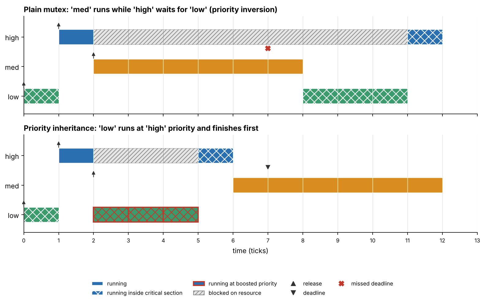
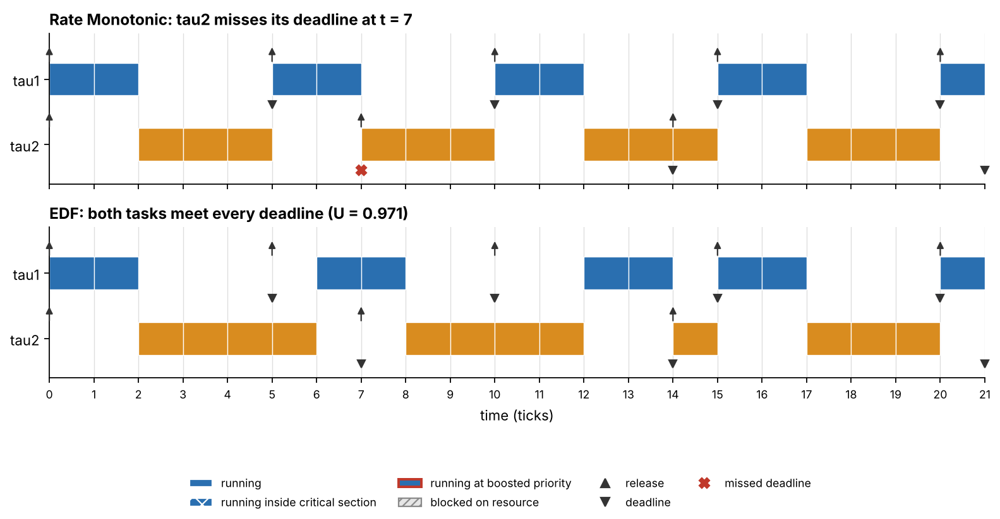
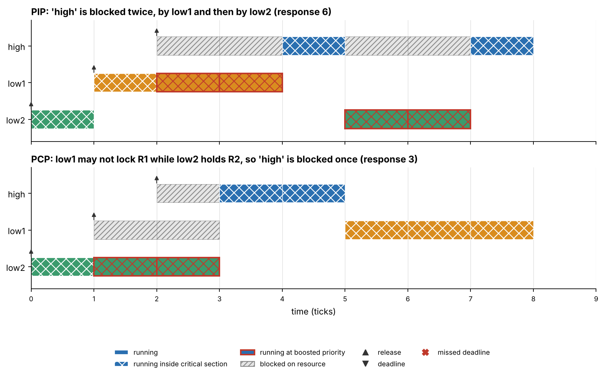
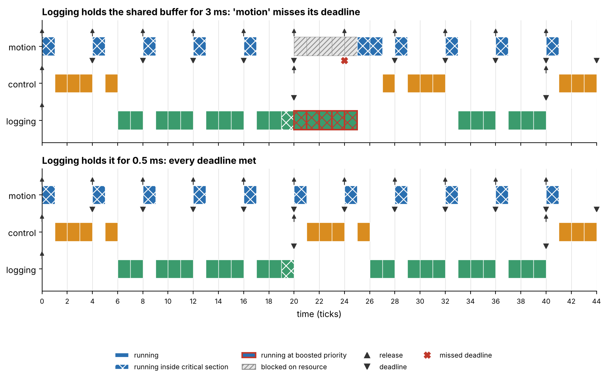

# Real-Time Scheduling Lab

[](https://github.com/Hal1lZtrk/realtime-scheduling-lab/actions/workflows/tests.yml)

**A small Python lab that answers one question: will my periodic tasks meet their deadlines?** It analyses a task set with the classic real-time theory, simulates it tick by tick, and checks that both answers agree on thousands of random task sets.



*Same three tasks, same shared resource. With a plain mutex the high-priority task misses its deadline (response time 11, deadline 6). With priority inheritance it finishes in 5.*

I built this after the *Real-Time Systems for Automation* course of my M.Sc. in Automation Engineering at the University of Bologna. The algorithms are the standard textbook ones (see [references](#references)); the code, tests and examples are my own. No course material is included.

## Why this matters for PLC and automation work

A PLC runs cyclic task classes (for example a fast motion class, a medium control class, a slow logging class) that share data. The same questions appear there: is the CPU load really the only limit? What happens when a slow task holds a lock that a fast task needs? This lab makes those effects visible. See the [PLC-style example](#4-plc-style-cyclic-task-classes) below.

## What is inside

| Part | What it does |
|---|---|
| `rtlab/analysis.py` | Utilization tests (Liu-Layland, hyperbolic), response-time analysis, EDF processor-demand test, blocking bounds for 4 resource protocols |
| `rtlab/simulator.py` | Preemptive uniprocessor simulator: RM, DM, EDF, with critical sections under `none`, `npp`, `hlp`, `pip`, `pcp` |
| `rtlab/plot.py` | Gantt charts with blocking, priority boosting, releases and deadline misses |
| `rtlab/validate.py` | Randomized cross-check of analysis against simulation |
| `linux_jitter/` | Optional C tool that measures real wake-up jitter of a periodic Linux task |

## Quick start

```bash
git clone https://github.com/Hal1lZtrk/realtime-scheduling-lab.git
cd realtime-scheduling-lab
pip install -r requirements.txt

python -m pytest -q                                   # 27 tests
python -m rtlab analyze  examples/rm_vs_edf.json
python -m rtlab simulate examples/plc_cyclic_classes_long_cs.json --alg rm --protocol pcp --png out.png --window 44
python -m rtlab validate --sets 2000 --seed 42        # analysis vs simulation
python scripts/make_figures.py                        # regenerate all figures
```

A task set is a small JSON file; critical sections are segments with a resource name:

```json
{"tasks": [
  {"name": "motion",  "period": 4,   "segments": [{"resource": "buf", "duration": 1}]},
  {"name": "control", "period": 20,  "wcet": 4},
  {"name": "logging", "period": 200, "segments": [
      {"resource": null,  "duration": 10},
      {"resource": "buf", "duration": 6},
      {"resource": null,  "duration": 14}]}
]}
```

## Four things the lab shows

### 1. RM vs EDF: the utilization bound is not the whole story

Two tasks, `tau1` (C=2, T=5) and `tau2` (C=4, T=7), utilization 0.971. That is above the RM bound of 0.828 for two tasks, and response-time analysis confirms `tau2` finishes at t = 8 > 7. EDF schedules the same set without any miss, because its bound is 1.0.



```text
$ python -m rtlab analyze examples/rm_vs_edf.json
RM least upper bound for n=2: 0.828  (U > bound -> test inconclusive); hyperbolic test: fail
EDF (preemptive, no resources): feasible - D = T for all tasks and U = 0.971 <= 1
...
task         prio    C     T     D          B       R  verdict
tau1            2    2     5     5          0       2  OK
tau2            1    4     7     7          0      >7  MISSES DEADLINE
```

### 2. Priority inversion and the five protocols

`low` locks resource R at t=0. `high` arrives at t=1 and needs R. `med` arrives at t=2 and does not need R at all. Without a protocol `med` keeps `low` from finishing, so `high` waits for a task that has nothing to do with it.

| Protocol | `high` response (deadline 6) | `med` response | How it works |
|---|---|---|---|
| plain mutex | **11 (miss)** | 6 | no protection |
| NPP | 5 | 10 | critical sections cannot be preempted |
| HLP | 5 | 10 | holder runs at the resource ceiling |
| PIP | 5 | 10 | holder inherits the priority of whoever it blocks |
| PCP | 5 | 10 | like PIP, plus a lock-grant rule based on ceilings |

All five Gantt charts are in [`images/priority_inversion_all_protocols.png`](images/priority_inversion_all_protocols.png). Under NPP and HLP, `high` is not shown as "blocked": it is simply ready and waiting, because it never gets to ask for the lock while `low` runs at the boosted priority.

### 3. Chained blocking: why the priority ceiling protocol exists

`high` needs R1 and then R2. `low1` holds R1 and `low2` holds R2 when `high` arrives. Under PIP `high` is blocked twice, once by each. Under PCP, `low1` is not allowed to lock R1 while `low2` holds R2 (the ceiling of R2 equals the priority of `high`), so `high` is blocked only once.



### 4. PLC-style cyclic task classes

*Illustrative numbers, not measurements of a real controller.* One tick = 0.5 ms. `motion` runs every 2 ms and needs 0.5 ms, `control` every 10 ms, `logging` every 100 ms. `motion` and `logging` share a data buffer.

Total utilization is only **0.60**, below the RM bound of 0.78 for three tasks, so a utilization check says "fine". But if `logging` holds the buffer for 3 ms while it copies a recipe, `motion` can be delayed by almost 3 ms, more than its own 2 ms deadline. Copying the data out in a 0.5 ms critical section fixes it.



```text
$ python -m rtlab analyze examples/plc_cyclic_classes_long_cs.json --protocol pcp
task         prio    C     T     D          B       R  verdict
motion          3    1     4     4          6      >4  MISSES DEADLINE
...
$ python -m rtlab analyze examples/plc_cyclic_classes_short_cs.json --protocol pcp
motion          3    1     4     4          1       2  OK
control         2    4    20    20          1       7  OK
logging         1   30   200   200          0      56  OK

SCHEDULABLE
```

The lesson: **critical section length of slow tasks matters as much as CPU load.**

## How I know it is correct

The analysis (closed-form and fixed-point iteration) and the simulator (tick by tick) are two independent implementations of the same theory. `python -m rtlab validate` generates random task sets and checks that they agree:

| Check | What is compared | Result (2000 random sets per kind, seed 42) |
|---|---|---|
| A | Fixed priorities, no resources: response-time analysis vs simulated worst case | 6,731 task checks, all **exactly equal**; 701 rejected tasks, all really miss in the simulation |
| B | EDF: demand-bound test vs simulation | 2,000 sets (1,186 feasible, 814 infeasible), decisions all agree |
| C | Resource protocols NPP/HLP/PIP/PCP with random phases and up to two critical sections per task | 29,900 task checks: no deadline miss when the analysis accepts, measured response never above the bound, measured blocking never above B<sub>i</sub>; 1,233 tasks with real blocking, 842 of them within one tick of the bound; under NPP/HLP/PCP no job is ever blocked by more than one lower-priority job |

I also checked that the checks can fail. Deliberately breaking the code (forcing a blocking bound to 0, removing the HLP priority boost, removing priority inheritance, an off-by-one in the response-time analysis) makes the validation report failures every time. The one rule random sets do not exercise is the PCP ceiling rule, so it has its own deterministic test (the chained-blocking scenario above).

Details and limits: [docs/validation.md](docs/validation.md).

## Limitations

- **One CPU, integer ticks.** No multicore, no fractional time.
- **No overheads.** Context-switch time, interrupt handling and release jitter are not modelled.
- **Critical sections are not nested.** This keeps the protocols easy to read; nested locking (and with it deadlock) is out of scope.
- **EDF with shared resources** supports only `none` and `npp`. The Stack Resource Policy is not implemented.
- **Response-time analysis needs D ≤ T.**
- **Tick model vs continuous time:** the blocking bound B is a continuous-time bound. With integer release times, a job released in the very tick in which the lock holder starts is not blocked at all (it runs first), so a single critical section of length d blocks for at most d − 1 ticks in the simulation. The validation shows measured blocking within one tick of the bound, never above it.
- The PLC example uses illustrative numbers. It is a teaching example, not a model of any specific controller.

More notes on design decisions: [docs/design-notes.md](docs/design-notes.md). A short primer on the theory: [docs/theory.md](docs/theory.md).

## Optional: how real is "real time" on Linux?

`linux_jitter/jitter.c` is a small C program that runs a periodic loop with `clock_nanosleep(TIMER_ABSTIME)` and records how late each wake-up is, optionally with `SCHED_FIFO` and competing CPU-load threads. It is the "reality check" for the theory above: standard Linux is a soft real-time system, and the numbers depend heavily on your machine and kernel.

```bash
gcc -std=gnu11 -O2 -Wall -Wextra -o linux_jitter/jitter linux_jitter/jitter.c -lpthread
./linux_jitter/jitter --period-us 10000 --seconds 30 --load 4 > lat_normal.csv
sudo ./linux_jitter/jitter --period-us 10000 --seconds 30 --load 4 --fifo 80 > lat_fifo.csv
python linux_jitter/plot_jitter.py lat_normal.csv lat_fifo.csv -o jitter.png
```

I deliberately do not publish latency numbers here: they would only describe one machine. ThreadSanitizer found a data race in my first version of this tool (the stop flag of the load threads was a plain `volatile`); it now uses a C11 atomic and the CI runs the thread and address sanitizers on every push.

## Repository layout

```text
rtlab/            analysis, simulator, plotting, validation, CLI
tests/            27 tests (unit tests, hand-computed scenarios, randomized cross-checks)
examples/         JSON task sets
scripts/          make_figures.py regenerates every image
linux_jitter/     optional C jitter measurement tool
docs/             theory primer, validation details, design notes
images/           generated figures
```

## References

- G. C. Buttazzo, *Hard Real-Time Computing Systems: Predictable Scheduling Algorithms and Applications*, 3rd ed., Springer, 2011.
- C. L. Liu, J. W. Layland, "Scheduling Algorithms for Multiprogramming in a Hard-Real-Time Environment", *Journal of the ACM* 20(1), 1973.
- L. Sha, R. Rajkumar, J. P. Lehoczky, "Priority Inheritance Protocols: An Approach to Real-Time Synchronization", *IEEE Transactions on Computers* 39(9), 1990.
- S. K. Baruah, L. E. Rosier, R. R. Howell, "Algorithms and Complexity Concerning the Preemptive Scheduling of Periodic, Real-Time Tasks on One Processor", *Real-Time Systems* 2(4), 1990.
- E. Bini, G. Buttazzo, G. Buttazzo, "A Hyperbolic Bound for the Rate Monotonic Algorithm", *Proc. 13th Euromicro Conference on Real-Time Systems*, 2001.

## Author

Ibrahim Halil Öztürk, M.Sc. in Automation Engineering, University of Bologna.
LinkedIn: [linkedin.com/in/i-halil-öztürk-541685287](https://www.linkedin.com/in/i-halil-öztürk-541685287)

Released under the [MIT License](LICENSE).
